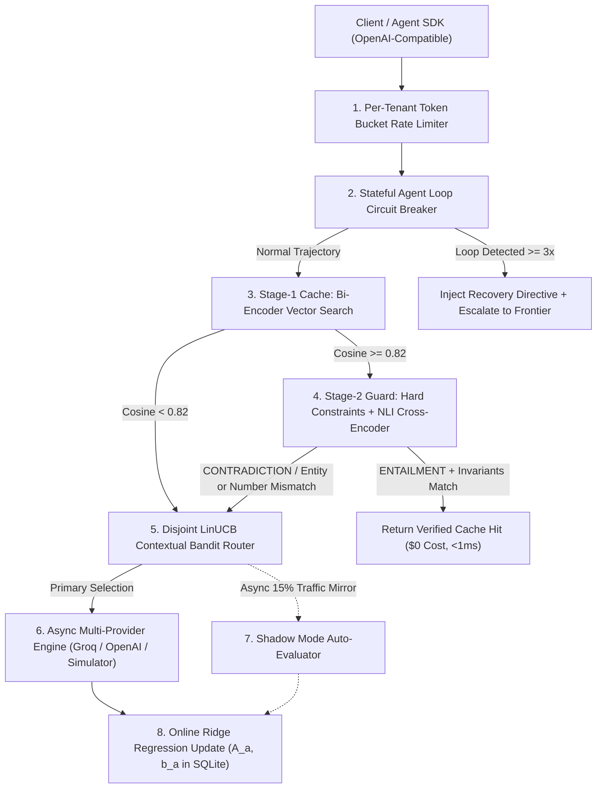

# VeriRoute: Entailment-Verified Semantic LLM Gateway & Contextual Bandit Router

**VeriRoute** is an OpenAI-compatible AI Gateway and Speculative/Adaptive Router engineered to solve three production failure modes of standard LLM proxies (such as vanilla GPTCache or static prompt routers):

1. **The "Semantic Cache Trap" (Solved via Two-Stage Bi-Encoder + NLI Cross-Encoder Verification):**
   Standard vector caches rely on cosine similarity, which yields `>0.90` similarity on opposite queries like *"How do I enable CORS in FastAPI?"* vs. *"How do I disable CORS in FastAPI?"*, or *"Transfer \$500 to Alice"* vs. *"Transfer \$500 to Bob"*. VeriRoute pairs fast Stage-1 vector retrieval with a Stage-2 **Natural Language Inference (NLI) Cross-Encoder & Deterministic Constraint Guard** (verifying numerical invariants, named entities, directional prepositional roles, and negation/antonym polarity) in **<1ms P95 overhead**.
2. **Static Prompt Routing Drift (Solved via Online Disjoint LinUCB Contextual Bandits):**
   Instead of a static offline classifier, VeriRoute frames model routing as a **Contextual Multi-Armed Bandit** ($\text{LinUCB}$). It extracts an 8-dimensional prompt complexity & domain vector $\mathbf{x}_t \in \mathbb{R}^8$, balances **exploitation** and **uncertainty-driven exploration** ($\alpha_t \sqrt{\mathbf{x}_t^\top \mathbf{A}_a^{-1} \mathbf{x}_t}$), incorporates live **Time-To-First-Token (TTFT)** EMA latency penalties, and updates ridge regression weights ($\mathbf{A}_a, \mathbf{b}_a$) online via **asynchronous Shadow-Mode Evaluations** and explicit/implicit feedback.
3. **Agentic Infinite Tool-Call Loops (Solved via Stateful Trajectory Circuit Breaking):**
   Tracks multi-turn agent trajectories across `session_id` traces, detects repetitive tool calls or semantic output cycles, injects a corrective loop-breaking system directive, and escalates the stuck turn to a Frontier reasoning model.

---

## System Architecture



---

## Empirical Benchmark Results

Run reproducible benchmarks anytime with:
```bash
python -m benchmarks.run_benchmarks
```

### Benchmark 1: Adversarial Semantic Cache Verification (27 Curated Pairs)
Evaluated across true paraphrases, antonym flips (*enable/disable*, *encrypt/decrypt*, *ascending/descending*), explicit negations, numerical swaps (*\$500 vs \$5000*), entity swaps (*Alice vs Bob*, *FastAPI vs Flask*), and directional role reversals (*checking $\to$ savings* vs *savings $\to$ checking*):

| Metric | Vanilla Cosine Cache (`>0.80`) | VeriRoute 2-Stage NLI Cache |
| :--- | :---: | :---: |
| **Adversarial False Positive Rate** *(Lower is better)* | 84.21% (16/19 failed) | **0.00% (0/19 failed)** |
| **Precision** | 33.33% | **100.00%** |
| **Paraphrase Recall** | 100.00% | **100.00%** |
| **P95 Verification Latency** | 0.45 ms | **0.75 ms** |

### Benchmark 2: Contextual Bandit Router Pareto Frontier (96 Mixed Workloads)

| Routing Policy | Total Cost (USD) | Cost Savings vs. Frontier | Avg Quality Score | Quality Parity | Avg TTFT Latency |
| :--- | :---: | :---: | :---: | :---: | :---: |
| **Always Frontier (`claude-3-5-sonnet`)** | \$0.07758 | 0.00% | 0.978 | 100.00% | 264.23 ms |
| **Always Small (`llama-3.1-8b-instant`)** | \$0.00046 | 99.41% | 0.790 | 80.81% | 42.68 ms |
| **Static Token-Length Heuristic** | \$0.00947 | 87.80% | 0.921 | 94.25% | 126.11 ms |
| **VeriRoute Online LinUCB Bandit** | **\$0.01977** | **74.52%** | **0.930** | **95.13%** | **115.08 ms** |

---

## Quickstart (Zero-Dependency Local Demo)

### 1. Install Dependencies
```bash
pip install -r requirements.txt
```

### 2. Run the Gateway & Interactive Web Dashboard
```bash
python -m uvicorn app.main:app --reload --port 8000
```
Open **`http://localhost:8000`** in your browser to access the interactive control center:
- **Tab 1 — Adversarial NLI Cache Lab:** Test negation traps, entity swaps, number swaps, and safe paraphrases side-by-side.
- **Tab 2 — Live Gateway & LinUCB Inspector:** Send requests to `/v1/chat/completions`, inspect the 8D context vector $\mathbf{x}_t$ and UCB exploration bonuses, and send live thumbs-up/down reward updates.
- **Tab 3 — Bandit Matrix State & Agent Loop Breaker:** Inspect learned ridge regression weights $\hat{\boldsymbol{\theta}}_a = \mathbf{A}_a^{-1}\mathbf{b}_a$ and simulate a stuck multi-turn tool-calling agent.
- **Tab 4 — Automated Benchmark Suite:** Execute the full 27-pair + 96-workload evaluation suite in one click.

### 3. Run Unit & Integration Tests
```bash
python -m pytest -v
```

---

## Repository Structure

- [`app/main.py`](app/main.py): FastAPI gateway server (`/v1/chat/completions`, SSE streaming, `/api/v1/cache/compare`, `/api/v1/feedback`, `/metrics`).
- [`app/cache/embeddings.py`](app/cache/embeddings.py): Stage-1 Bi-Encoder dense concept & n-gram embedding engine (with optional ONNX Runtime provider).
- [`app/cache/constraints.py`](app/cache/constraints.py): Deterministic invariant verifier for numbers, proper nouns/entities, negation polarity, and antonym pairs.
- [`app/cache/nli_verifier.py`](app/cache/nli_verifier.py): Stage-2 Cross-Encoder NLI verifier computing $P(\text{Entailment}), P(\text{Neutral}), P(\text{Contradiction})$.
- [`app/cache/semantic_cache.py`](app/cache/semantic_cache.py): Two-stage cache manager tracking verified hits and prevented adversarial false positives.
- [`app/router/features.py`](app/router/features.py): Extracts 8D normalized context vectors $\mathbf{x}_t \in \mathbb{R}^8$ and domain complexity classifications.
- [`app/router/bandit.py`](app/router/bandit.py): Disjoint LinUCB contextual bandit with pull-annealed exploration, EMA TTFT latency penalties, and SQLite persistence.
- [`app/guardrails/loop_detector.py`](app/guardrails/loop_detector.py): Stateful agent tool-call loop circuit breaker.
- [`app/eval/shadow.py`](app/eval/shadow.py): Asynchronous background shadow traffic evaluator.
- [`benchmarks/run_benchmarks.py`](benchmarks/run_benchmarks.py): CLI & programmatic evaluation benchmark suite.
- [`INTERVIEW_GUIDE.md`](INTERVIEW_GUIDE.md): Resume bullets, mathematical derivations, and SWE/AI interview Q&A prep.

---

## License

This project is licensed under the [MIT License](LICENSE).

